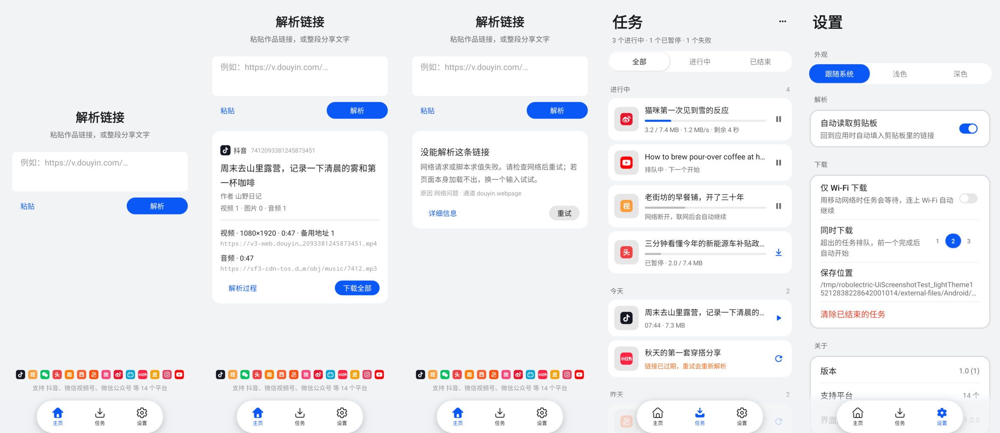
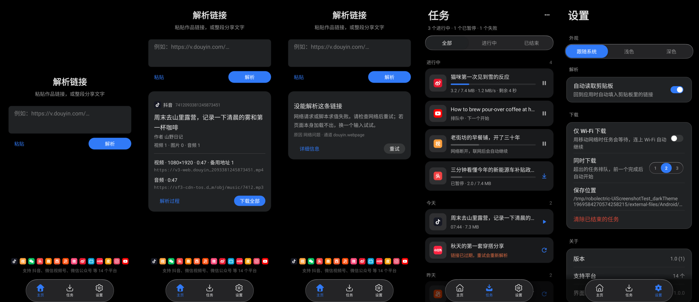
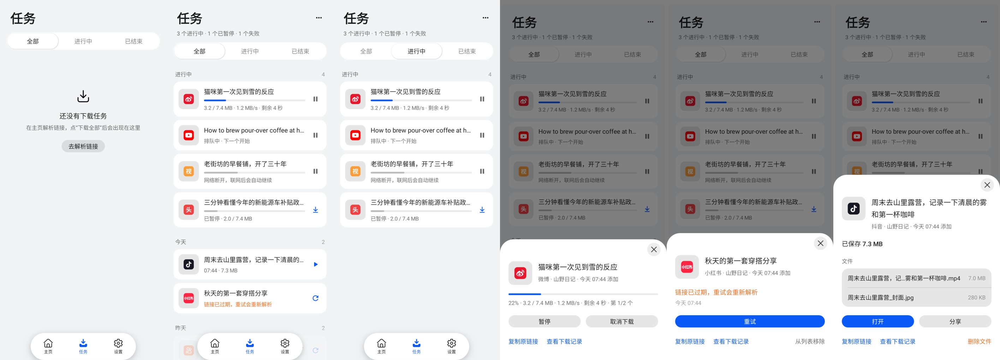
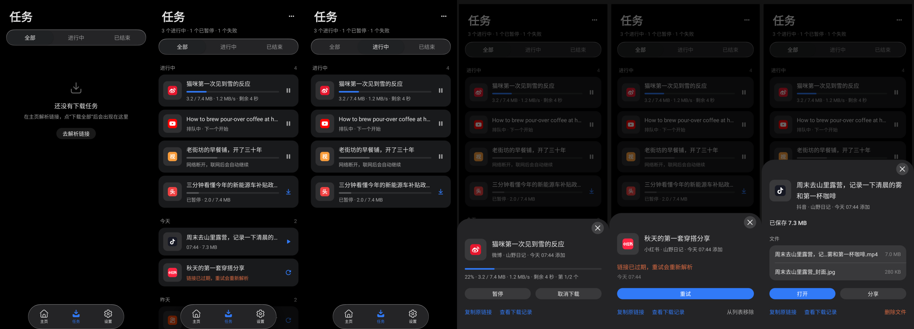

# 06 · UI 设计（DESIGN.md）

本文是 YoUrlDown 界面的设计依据。基础组件、颜色、字号、圆角来自 YoUI Kit（HDS 对齐）；
YoUI 只是公共基础库，本应用特有、或 Kit 里没有合适形态的组件放在 `app/.../ui/widget/`，
颜色、字体仍然从 `YoColors` / `YoFonts` 取，不另起一套色板。本文规定 **怎么用**：版式、层级、文案，以及哪些做法不要用。

| App 侧组件 | 用途 | 为什么不用 Kit 现成的 |
| --- | --- | --- |
| `ProgressLine` | 任务卡片与详情里的 4dp 圆头进度条；大小未知时显示往返滑块；暂停 / 等网络时变灰 | Kit 的进度条偏高、没有不确定态，列表里显得笨重 |
| `IconAction` | 40dp 无界水波的图标按钮（暂停 / 继续 / 重试 / 播放 / 打开 / ⋯） | 卡片只需要一个图标，文字按钮太占宽 |
| `GroupSurface` | 16dp 圆角平面分组，行间分隔线左侧内缩、首尾行随圆角裁切 | Kit 卡片是单块内容，没有“多行一组”的形态 |
| `TaskThumb` | 圆角缩略图，也是任务唯一的平台标识位（卡片 48dp、详情 56dp）：没图时浅底 + 平台图标，有封面 / 本地文件时铺图并在右下角压平台小标 | 任务专属 |
| `PlatformMark` | 平台标识图标：品牌色圆角方块 + 白色字形（`res/drawable/ic_platform_*.xml`，由 `tools/icons/gen_platform_icons.py` 从 simple-icons 生成，没有收录的平台用 Noto Sans SC 粗体首字） | 任务缩略图、结果卡、主页平台行共用，同一平台到处长得一样 |
| `TaskCardView`（`ui/tasks`） | 任务卡片：缩略图 | 标题 / 进度 / 状态 | 一个操作 | 任务专属 |
| `ThumbnailLoader` | 本地视频取帧、图片缩放，没有本地文件时取封面 URL；内存 LRU | 与界面无关的加载逻辑，不放进 Kit |

## 1. 参考来源与取舍

| 来源 | 学到的 | 没照搬的 |
| --- | --- | --- |
| [Apple DESIGN.md](https://github.com/VoltAgent/awesome-design-md/tree/main/design-md/apple) | 界面退后，让内容说话；全局只有一个强调色，只给可点的东西用；阴影只用来表达“浮起” | 营销页的大图与明暗交替分段：工具应用没有产品图 |
| [Linear DESIGN.md](https://github.com/VoltAgent/awesome-design-md/tree/main/design-md/linear.app) | 层级靠表面明度阶梯，而不是阴影；强调色不做大面积底色 | 纯深色画布：我们跟随系统深浅色 |
| [Raycast DESIGN.md](https://github.com/VoltAgent/awesome-design-md/tree/main/design-md/raycast) | 卡片内边距收紧在 16–24；状态色只用在小面积的状态标记上 | 只做深色、键帽装饰 |
| [anti-ai-slop](https://github.com/muris11/anti-ai-slop)（ui / mobile / nav / forms / copywriting） | 见第 2 节的“不要”清单与第 6 节自查表 | — |

## 2. 原则

1. **一页一件事。** 主页只做“输入链接 → 看结果”；任务页只看下载；设置页只放真实可改的项。
2. **一个强调色。** `YoColors.brand()` 只出现在：主按钮、选中的页签、进度条、卡片上的主操作图标。
   唯一例外是平台图标：用各平台自己的品牌色，因为它是“这是哪家的”标识，不是装饰；尺寸压在 16–20dp，不成色块。
   失败用 `alert()`，只用在缩略图角标和一行说明上，不给整行上色；完成不加颜色，靠“播放 / 打开”操作表达。
3. **平放优先。** 卡片、列表都不加阴影（`setShadowEnabled(false)`）。层级靠
   `backgroundSecondary`（页底）与 `componentBackgroundPrimary`（卡面）的明度差。
4. **只展示真实数据。** 引擎没返回的字段就不显示，不用“未知 / 暂无”凑满版面；
   平台数量、清单从 `Platform` 枚举读，不写死。
5. **原生习惯。** 底部三个页签、系统深浅色、键盘弹出时输入框停在键盘上方、系统分享面板可直接把链接交给本应用。

## 3. 不要（来自 anti-ai-slop，结合本项目）

- 不要渐变背景、光晕、毛玻璃导航。底栏用 YoTabs **悬浮胶囊**（`FLOATING` + 内容可滚到其下 + 下滑隐藏 / 上滑出现），
  不加模糊与渐变。D-7 认为悬浮导航默认是“AI 味”信号、除非有明确理由；这里的理由是：任务页是长列表，
  胶囊在滚动时让出整条底边，卡片底部的操作不会被固定底栏挡住；同时与 YoUI Kit 的 HDS 悬浮页签规格一致。
- 不要“图标方块 + 大标题 + 宣传语 + 双按钮”的营销首屏（K-8、C-1）。主页没有 Logo 方块，标题是动作“解析链接”，不是口号。
- 不要两个同权重的并排按钮。主页只有“解析”是主按钮，“粘贴”是文字按钮。
- 不要占位开关。设置里每一项都接了真实行为（“仅 Wi‑Fi”“同时下载”直接作用于调度器）；没做的能力不出现（G-1：不做事的按钮是 P4）。
- 不要空洞文案：一键、轻松、智能、极速、强大、赋能、全新体验……一律不用。文案说清“做什么 / 发生了什么 / 下一步”。
- 不要只靠禁用按钮表达状态。输入为空时点“解析”，在输入框下给出原因，而不是把按钮置灰。
- 破坏性操作要确认。“清除已结束的任务”弹窗说明只删记录、不删文件。

## 4. 版式与尺寸

- 间距阶梯：4 / 8 / 12 / 16 / 24 / 32 / 48 dp。组内 4–12，组间 16–24，区块间 24+。不全页统一一个值。
- 页面左右边距 16 dp；主页内容最大宽度 520 dp（平板、横屏不拉满）。
- 字号：页大标题 30、主页标题 24、卡片标题 17、正文 14、辅助 13、注脚 12（sp）。字体用 `YoFonts`。
- 圆角、控件高度、触控区全部用 Kit 默认值，应用侧不再自定义。

## 5. 页面

### 主页
- 空闲态：标题“解析链接” + 一行说明 + 多行输入框（3–6 行）+ 操作行（左“粘贴”文字按钮，右“解析”主按钮）。
  这一组在可视区垂直居中，上下留白 2:3（视觉中心略高于几何中心）。底部一排平台图标（屏幕放得下几个放几个）+ 一行“支持 B站、抖音、快手 等 N 个平台”。
- 解析中：主按钮显示加载态，输入框与粘贴暂时不可用。
- 成功：结果卡接在操作行下方，顶部留白收起，输入区上移。卡内依次是平台图标 + 名称与作品 ID、标题（≤3 行）、作者、
  媒体数量、媒体明细（最多 4 条，URL 单行中间省略）、操作（左“解析过程”，右“下载全部”）。
  点“下载全部”后按钮变为次级的“查看任务”，点它切到任务页；同一链接已有任务时先弹提醒（见 07）。
- 失败：同位置换成失败卡：一句结论 + 引擎给的提示 + 原因 / 通道；可重试时给“重试”。
- 剪贴板：设置开启时，回到应用且输入框为空，自动填入剪贴板里的链接（同一段文字只填一次）。

### 任务
- 顶栏：大标题“任务” + 右侧 ⋯ 菜单（全部暂停 / 全部继续 / 重试全部失败的 / 清除已结束的，没有对应任务时不出现该项）。
  副标题只说有意义的数：“2 个进行中 · 1 个已暂停 · 1 个失败”；都结束时显示“共 N 个任务”。
- 分段筛选：全部 / 进行中 / 已结束。
- 分组：未结束的（下载中 → 排队 / 等网络 → 已暂停）置顶为一组；其余按**自然日**分组（今天 / 昨天 / M月d日），组头带计数。
  每个任务一张卡片，卡片间距 8dp。
- 卡片（`TaskCardView`）固定版式，所有状态一样高：缩略图 48dp | 标题（一行）+ 进度条（只在未结束时）+ 状态行（一行）| **一个**操作。
  - 平台只在缩略图位置标识一次：没封面时缩略图就是平台图标，有封面时右下角压一个 16dp 平台小标。卡片上不再另放平台图标、平台名、作者、媒体明细，这些在详情面板里。
  - 状态只说一次，不另挂状态标签。状态行：下载中“3.2 / 7.4 MB · 1.2 MB/s · 剩余 5 秒”、阶段“合并音视频…”、排队“排队中 · 前面还有 2 个”、
    暂停“已暂停 · 3.2 / 7.4 MB”、等网络写原因、完成“14:05 · 7.4 MB”、失败写原因（`alert` 色）、取消“14:05 取消”。暂停 / 等网络时进度条变灰。
  - 操作只给当前状态最常用的一个：下载中 / 排队 / 等网络“暂停”、已暂停“继续”、失败 / 取消“重试”、完成的视频“播放”、其他完成“打开”。
    取消、分享、复制链接、删除等放长按菜单和详情面板。没有操作时按钮位置留空，卡片右缘对齐。
- 进度刷新只更新进度条和状态行（`bindProgress`），不重建列表。
- 点卡片：底部面板（`YoSheet`，按内容高度）。头部缩略图（同卡片，带平台标识）+ 标题 + “平台 · 作者 · 今天 14:05 添加”；
  状态区（进度 / 暂停或等网络的原因 / 失败原因 / 保存大小）；文件列表（点开单个文件）；主按钮 + 次按钮（如“打开”+“分享”、“暂停”+“取消”）；
  底部文字链接：复制原链接 / 查看下载记录 / 删除文件（`alert` 色，有本地文件时才出现）/ 从列表移除；下载记录用等宽字体。面板随任务状态实时刷新。
- “删除文件”弹确认，写明会删除几个文件、任务也会移出列表；“从列表移除”不删文件。
- 落盘：任务列表写到 `files/tasks.json`（后台单线程原子写，最多 300 条）。进程被杀时没下完的任务恢复为“已暂停（中断）”，
  启动后自动继续；没有原始解析结果时按原链接重新解析。完整状态与后台规则见 [07-操作流程.md](07-操作流程.md)。
- 空态分两种：从未下载（一句说明 + “去解析链接”按钮回主页）、筛选后为空（一句话）。不放插画。

### 设置
- 外观：跟随系统 / 浅色 / 深色（分段按钮），即时生效。
- 解析：自动读取剪贴板（开关 + 一句说明）。
- 下载：保存位置（只读路径）、仅 Wi‑Fi 下载（开关 + 一句说明）、同时下载 1 / 2 / 3（分段按钮）、清除已结束的任务（需确认）。
- 关于：版本、支持平台数、界面组件版本。

## 6. 交付前自查

- [ ] 页面上每个可点元素都接了真实行为。
- [ ] 强调色出现的位置不超出第 2 节列出的范围。
- [ ] 新组件先看 Kit 有没有；没有才放 `ui/widget/`，并且颜色、字体从 Kit 取。
- [ ] 没有阴影、渐变、光晕、毛玻璃。
- [ ] 加载 / 空 / 失败 / 成功四种状态都有设计。
- [ ] 键盘弹出时输入框可见；底栏不遮内容。
- [ ] 浅色、深色截图都检查过（`UiScreenshotTest`）。
- [ ] 文案里没有第 3 节列出的空洞词。

## 当前效果

Robolectric 渲染（`UiScreenshotTest`，393×852dp xxhdpi）。非真机截图，字体与阴影和真机略有差别，只用于排版自查；改界面后重跑测试再更新这些图。

总览，从左到右：主页空闲 / 解析成功 / 解析失败 / 任务列表 / 设置。

任务页，从左到右：空态 / 全部 / 进行中（下载、排队、暂停、等网络）/ 详情（下载中）/ 详情（失败）/ 详情（完成）。

> 真机复验矩阵（`tools/device-matrix.ps1`）通过结果卡的 `contentDescription` 读取「平台 / 通道 / 媒体」或「解析失败 / 原因 / 通道 / 详情」，
> 格式见 `ResultCard.matrixSummary`，截图测试里有断言保护。
