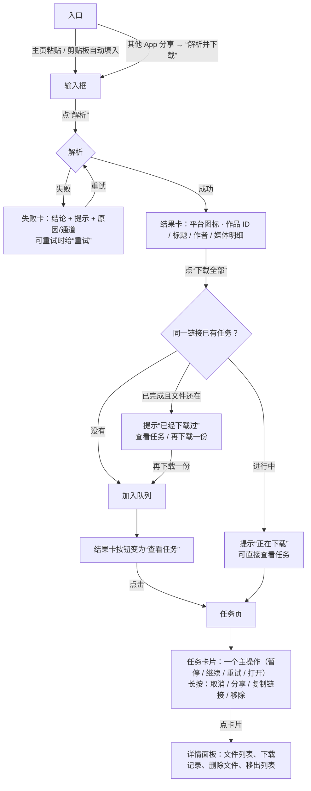
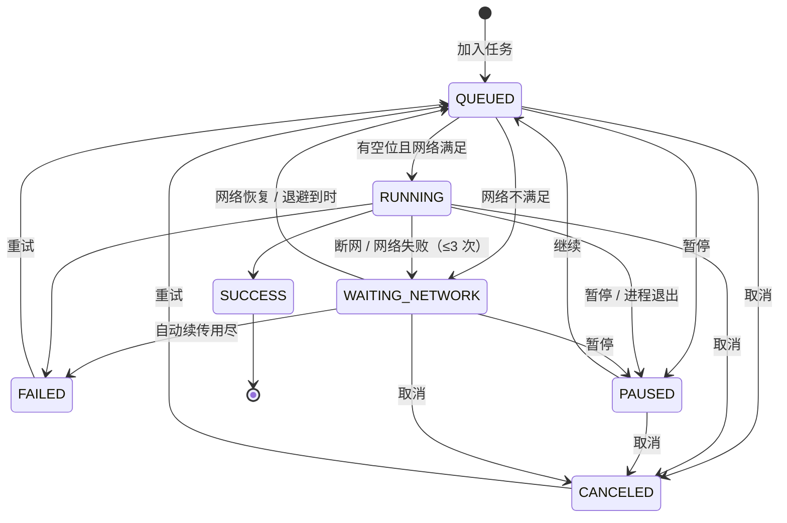

# 07 · 操作流程与任务状态

本文规定从「拿到链接」到「拿到文件」的完整流程：用户每一步看到什么、能做什么、系统在后台做什么。
状态迁移以代码为准（`task/DownloadTask.Status#canMoveTo`），本文的表与它一一对应，改一处必须改另一处。

## 1. 主流程

要点：

- **入口只有一个输入框。** 主页粘贴、剪贴板自动填入（设置可关）、系统分享（`ACTION_SEND text/plain`，
  分享面板里显示“解析并下载”）最终都落到同一个输入框并立即解析；分享进来的文字可以是整段文案，引擎自己找链接。
- **一个结果只排一次队。** 加入后按钮变成“查看任务”，不再是禁用的“已加入”——给下一步，而不是给死路。
- **重复检测按原链接。** 同一链接已有未结束的任务时不再新建；已完成且文件还在时先问，确认后才再下一份。
  已完成但文件被删了，视为没有，直接排队。
- 第一次排队时申请通知权限（Android 13+，只问一次），用于前台服务进度通知。

## 2. 任务状态

| 状态 | 卡片状态行 | 进度条 | 卡片操作 | 说明 |
| --- | --- | --- | --- | --- |
| `QUEUED` 排队 | 排队中 · 前面还有 N 个 | 不显示 | 暂停 | 按入队先后等空位 |
| `RUNNING` 下载中 | 3.2 / 7.4 MB · 速度 · 剩余时间；或阶段（重新解析 / 合并 / 检查） | 品牌色 | 暂停 | 阶段：重新解析 → 下载 → 合并 → 校验 |
| `PAUSED` 已暂停 | 已暂停 · 3.2 / 7.4 MB | 灰色，停在断点 | 继续 | 用户暂停；或进程退出时被中断 |
| `WAITING_NETWORK` 等待网络 | 原因（如“网络断开，联网后会自动继续”） | 灰色，停在断点 | 暂停 | 断网 / 不满足“仅 Wi‑Fi”/ 下载途中网络失败，会自己恢复 |
| `SUCCESS` 已完成 | 14:05 · 7.4 MB | 不显示 | 播放 / 打开 | 文件被删时写“文件已被移动或删除” |
| `FAILED` 失败 | 原因（警示色，`DownloadError`） | 不显示 | 重试 | |
| `CANCELED` 已取消 | 14:05 取消 | 不显示 | 重试 | 半截文件与断点删除 |

卡片只放一个操作；取消、分享、复制链接、移除 / 删除文件在长按菜单和详情面板里。

### 2.1 允许的迁移

| 从 \ 到 | QUEUED | RUNNING | PAUSED | WAITING_NETWORK | SUCCESS | FAILED | CANCELED |
| --- | --- | --- | --- | --- | --- | --- | --- |
| QUEUED | | ✅ | ✅ | ✅ | | | ✅ |
| RUNNING | | | ✅ | ✅ | ✅ | ✅ | ✅ |
| PAUSED | ✅ 继续 | | | | | | ✅ |
| WAITING_NETWORK | ✅ 网络恢复 | | ✅ | | | ✅ 自动续传用尽 | ✅ |
| SUCCESS | | | | | | | |
| FAILED | ✅ 重试 | | | | | | |
| CANCELED | ✅ 重试 | | | | | | |

`SUCCESS` 是终态：要再下一份就重新排一个新任务（见第 1 节的重复提醒）。

## 3. 后台规则（`task/DownloadRunner`）

| 规则 | 行为 |
| --- | --- |
| 并发 | 同时运行数 = 设置“同时下载”（1 / 2 / 3，默认 2）；其余按入队先后排队。调大立即补位；调小不打断正在下的，等它们结束后按新上限 |
| 仅 Wi‑Fi | 按“不计费网络”判断。不满足时排队的进入等待网络，运行中的停在断点；满足后自动回到队列 |
| 自动续传 | 下载途中的网络类失败（`NETWORK` / `WIFI_REQUIRED` / `STALLED`）转入等待网络，最多 3 次，退避 3 s / 10 s / 30 s；网络回调到来时立即恢复。用尽后判失败 |
| 卡住检测 | 120 s 没有任何字节进展判 `STALLED`，按上一条续传 |
| 直链过期 | `LINK_EXPIRED`（403 / 404 / 410）时用原链接重新解析一次，拿到新地址后沿用同一引擎请求续传断点 |
| 断点 | 直链由 `lib_download` 的 SQLite 断点表续传；HLS 边下边追加到 `.part`，旁边的 `.part.idx` 记录播放列表地址、分片数与已完成分片；三者对得上才续传，否则从头下 |
| 取消 | 立即停止，删除半截文件和断点 |
| 前台服务 | 有未结束任务时 `DownloadService`（`dataSync`）常驻，通知栏显示“正在下载 N 个任务 / N 个等待网络 / N 个排队中”和“全部暂停”；全部结束即退出 |
| 进程退出 | 启动时把上次没下完的任务恢复为“已暂停（中断）”，并自动继续；没有原始解析结果的按原链接重新解析 |
| 落盘 | 任务列表写 `files/tasks.json`（后台单线程原子写，最多 300 条） |

## 4. 失败原因（`download/DownloadError`）

每个失败只给一句用户能理解的话，并决定能否重试 / 是否自动续传：

| 错误 | 可重试 | 自动续传 | 典型来源 |
| --- | --- | --- | --- |
| `NETWORK` | ✅ | ✅ | 断网、连接超时 |
| `WIFI_REQUIRED` | ✅ | ✅ | 开启“仅 Wi‑Fi”且当前是计费网络 |
| `STALLED` | ✅ | ✅ | 120 s 无进展 |
| `LINK_EXPIRED` | ✅ | 重新解析一次 | 403 / 404 / 410 |
| `SERVER` / `HTTP` | ✅ | — | 5xx / 其他状态码 |
| `NOT_MEDIA` | ✅ | — | 下下来的不是媒体（拦截页等） |
| `MERGE` | ✅ | — | 音视频合并失败 |
| `IO` | ✅ | — | 写文件失败 |
| `PARSE` | ✅ | — | 重新解析失败 |
| `STORAGE` | — | — | 空间不足 |
| `UNSUPPORTED` | — | — | 直播流等不支持的格式 |
| `NO_MEDIA` | — | — | 解析结果里没有可下载的媒体 |
| `UNKNOWN` | ✅ | — | 兜底 |

## 5. 批量操作

- 任务页 ⋯：全部暂停 / 全部继续 / 重试全部失败的 / 清除已结束的（没有对应任务时不出现该项）。
- 通知栏：全部暂停。
- “清除已结束的”需确认，只删记录不删文件；“删除文件”需确认并写明文件数。
